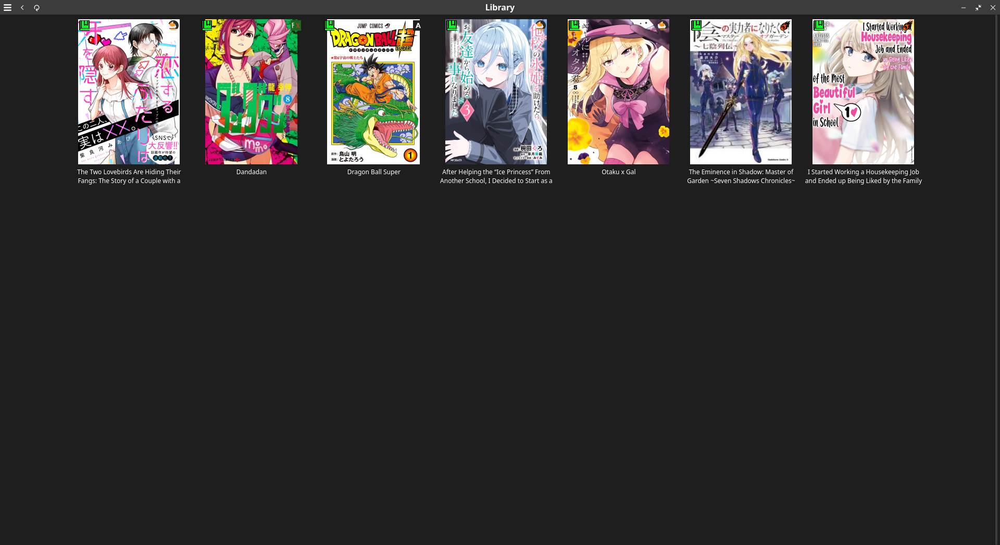
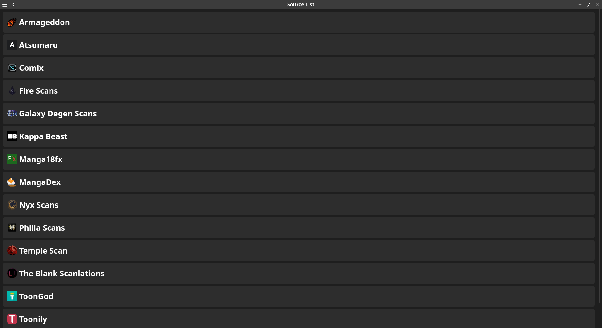
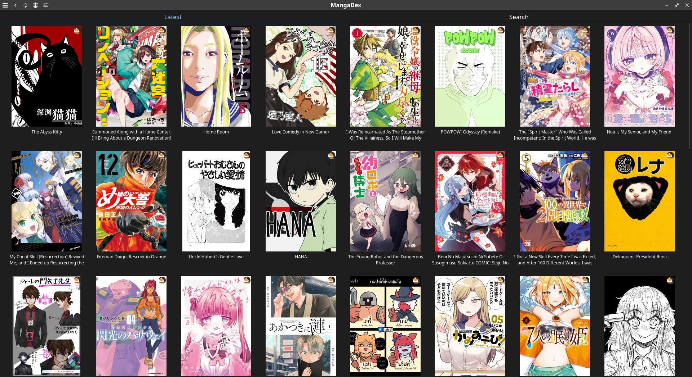
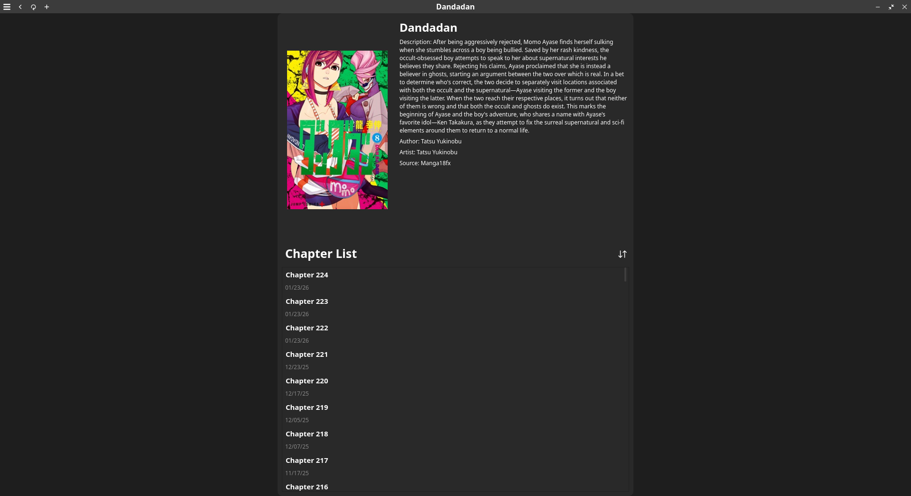
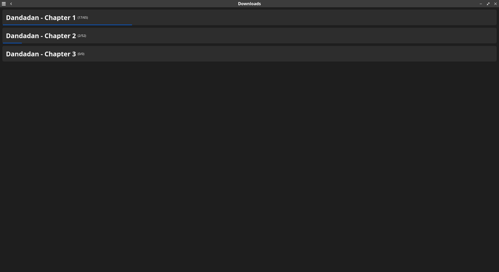
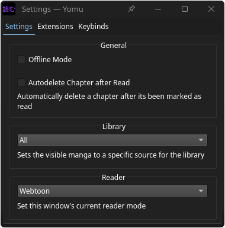

# Yomu

**Yomu** is a manga reader for Windows and Linux using PyQt6.

## License

**Yomu** is licensed under the [GPLv3](https://www.gnu.org/licenses/gpl-3.0.html)

## Features

* Reading using sources
* Downloading chapters locally for offline reading
    * Automatic deletion on read
* Various reading modes
    * Horizontal
    * Left-To-Right
    * Right-To-Left
    * Webtoon
* Library categories
* Extendibility via extensions

## Sources

Built in:
* Armageddon (Replaced by SilentQuill)
* Atsumaru
* Comick (Removed)
* Comix (Removed)
* Diva Scans (Removed)
* Eris Scans
* Firescans (Removed; Site Down)
* Galaxy Degen Scans
* Kappa Beast (Removed)
* Luna Toons
* Manga18fx
* Mangadex
* Mangadotnet
* Mangafire
* Nyx Scans
* Philia Scans
* SilentQuill
* Temple Scan (Removed)
* The Blank Scans (Removed)
* ToonGod
* Toonily
* WebtoonXYZ (Removed; Site Down)
* Weeb Central

If you wish to add your own sources, you can add them to:
* Windows: `C:\\Users\\<name>\\AppData\\Local\\sources`
* Linux: `~/.local/Yomu/sources`

Once you've added the source, restart Yomu  

Note: Sources may not be up to date. Yomu will not auto update the external sources

## Extensions

Extensions allow you to add features to the reader without having to write it directly into the reader. You can add them to:

* Windows: `C:\\Users\\<name>\\AppData\\Local\\extensions`
* Linux: `~/.local/Yomu/extensions`
 
Once you've added the extension, restart Yomu

Current Extensions:

| Name | Description |
| --- | --- |
| [Yomu-Server](https://github.com/Srpboyz/Yomu-Server) | A server that runs in the background allowing you to read on other devices |
| [Acrylic-Theme](https://github.com/Srpboyz/Yomu-Acrylic-Theme) | An acrylic theme for Yomu |
| [Discord-RPC](https://github.com/Srpboyz/Yomu-Discord) | Displays what you are currently doing on Yomu as a discord game status |

Note: Yomu will not auto-update the extension. Please be aware that extensions have full access/control to the app

## Screenshots

    
Click to view images

    
    
    
    
    
    
    

## Usage

### Python
1. Clone the repository
2. Run `poetry install`
3. Activate the virtual environment
4. Run `python -m yomu`

### Executable
1. Download zip file from releases
2. Unzip the file
3. Run the executable
    * `yomu.exe` on Windows
    * `yomu-reader` on Linux

## Uninstall
1. Go to your local app data directory
    * Windows: `C:\\Users\\<name>\\AppData\\Local`
    * Linux: `~/.local/share`
2. Delete the Yomu folder